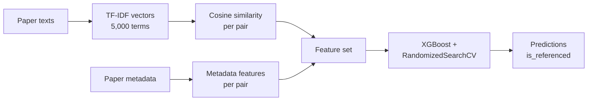

# GAMMAFEST 2025: Citation Link Prediction (Team Stunting)

> Predicting whether one research paper cites another, using **TF-IDF text similarity**, **paper metadata features** and a tuned **XGBoost** classifier. Built by Team Stunting for the GAMMAFEST 2025 data science competition.


---

## Overview

The competition provides a database of **4,354 research papers** (full text plus metadata) and a list of paper pairs. For each pair, the goal is to predict `is_referenced`: whether the first paper cites the second.

The data is heavily imbalanced. Only about 1% of the **410,691 training pairs** are real citations, so accuracy alone says little and the notebook reports the **Matthews Correlation Coefficient (MCC)** instead.

## Approach



The model uses six features for each paper pair:

| Feature | Meaning |
|---|---|
| `text_similarity` | Cosine similarity between the two papers' TF-IDF vectors |
| `year_diff` | Difference in publication year |
| `invalid_citation` | 1 if the cited paper is newer than the citing paper, which makes a citation unlikely |
| `author_overlap` | Number of authors the two papers share |
| `concept_overlap_count` | Number of research concepts the two papers share |
| `type_match` | 1 if both papers are the same document type |

The XGBoost classifier is tuned with `RandomizedSearchCV` (10 candidates, 3-fold stratified cross-validation) over the number of trees, depth, learning rate, subsampling and column sampling.

## Results

Evaluated on a stratified 20% validation split (82,139 pairs, 858 real citations):

| Metric | Value |
|---|---|
| MCC | **0.417** |
| Precision (citation class) | 0.63 |
| Recall (citation class) | 0.28 |
| F1-score (citation class) | 0.39 |

When the model predicts a citation it is right 63% of the time, but it finds only 28% of the real citations. Tuning the decision threshold, or adding richer text features such as embeddings, would be the next step to improve recall.

## Getting Started

1. Download the competition data: `train.csv`, `test.csv`, `papers_metadata.csv` and the `Paper Database` folder of `.txt` files.
2. Install the dependencies:
   ```bash
   pip install pandas scikit-learn xgboost tqdm joblib jupyter
   ```
3. Open `Team Stunting_Notebook.ipynb` and set `BASE_DIR` in the first cell to the folder that holds the data.
4. Run all cells. The notebook writes a submission CSV and saves the trained model with `joblib`. Update the output paths in the last cells to match your machine.

## Repository Structure

```
Gammafest_TeamStunting/
├── Team Stunting_Notebook.ipynb   # Feature engineering, training, evaluation and submission
├── LICENSE
└── README.md
```

## License

Released under the [Apache License 2.0](LICENSE).

## Author

**Athaya Akbar** and Team Stunting: [GitHub @athaaaya](https://github.com/athaaaya)
